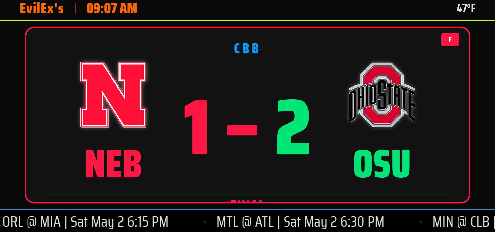

# Auggmented Scoreboard


**Current version: 1.7.1** · [Download the latest release](https://github.com/auggnation/Auggment-Scoreboard/releases/latest) · [What's new](#whats-new-in-171)

## What's New in 1.7.1

**Sign-in security.** Update the server and every kiosk, then sign in once on each to set its password. Do it soon after updating: until then the old or factory password still opens the password screen.

* **Change your password at first sign-in.** The settings stay locked until you do. Existing installs are asked once too, even if the password had been changed before.
* **Password rules** — at least 8 characters; common and trivial passwords, your username and the previous password are refused.
* **Guessing is slowed** — after 5 wrong tries an address must wait 1 minute, doubling up to 15; a flood from many addresses pauses sign-in for 5 minutes. Pairing codes are limited the same way.
* **The password is no longer exposed** — it is stored hashed, and `/api/settings` (which used to give it to anyone on the network) now returns only the theme unless you are signed in.
* **Sessions** — each install has its own signing key (it used to be one public value everywhere, so sign-ins could be forged). Signing out, changing the password or restarting ends sessions; they expire after 12 hours.
* **Other websites cannot act for you** — cross-site requests are refused, and the sign-in and settings pages cannot be framed.
* **Injected text** — Wi-Fi network names and kiosk names can no longer run code on the settings page.
* **Linux-account sign-in removed** — on many installs it accepted any password.
* **Kiosks** — update downloads now require the kiosk's pairing token, and the pairing status page requires sign-in.
* **Private files** — `settings.json`, `kiosk.json`, `paired_kiosks.json` and the session key are readable only by the service account.

## What's New in 1.6.5

**Installer fixes**, tested on fresh Debian 12, Debian 13 and Ubuntu 24.04 virtual machines. If you already have the scoreboard installed: update, reboot the device once, then re-run `install.sh` from the 1.6.5 download. Your settings are kept.

* Ubuntu and Debian 12 (including Raspberry Pi OS based on it) no longer stop on a missing `python3-pytz` package, and Ubuntu no longer stops while installing Chromium.
* Combined and server installs stay on port 5000 — opening Settings could move them to 5001 after a restart.
* Images that boot to a text console now boot to the kiosk screen.
* The kiosk launcher no longer remembers the folder the installer was run from.
* **Restart Backend** and the reboot after **Apply Update** now work. Until `install.sh` has been re-run on an existing install, the app restarts its own service instead of rebooting.

## What's New in 1.6

**Cutting down on API polling.** Version 1.5 still asked ESPN far too often: any game in any selected league was polled every 30 seconds, favorite or not, which added up to many thousands of requests a day and risked getting the address blocked. In a simulated 12-league Saturday, 1.5 sent about **14,000** requests. 1.6 sends about **420**.

* **Midnight read** — schedules are fetched once, just after local midnight, usually one request per league per month. If nothing is happening, that is all for 24 hours.
* **Game day** — a favorite's game later today is checked every 3 hours until it starts.
* **Live** — once a minute, only while a favorite's game is on.
* **You choose the pace** — an update interval from 1 minute to 24 hours (default 24), favorites-only (default) or every-game polling. This replaces `live_favorites_only`.
* **Guard rails** — every request is counted and shown in Settings, capped at 3,000 a day, and a refusal from ESPN (429/403) pauses requests for 30 minutes.
* **Offline** — a paired kiosk shows its server's saved data when the server is unreachable instead of going to ESPN.

Also in this release:

* **Quick switch** card transition, adjustable from 0.2 to 1.9 seconds.
* **Reorganized settings** — Games, Updates, Screen, Look and Device pages with a live status strip.
* **Fixed** — NASCAR now uses ESPN's current series address.

Good to know when upgrading: in favorites-only mode, leagues where you follow nobody update their ticker scores overnight; a paired kiosk now takes its slide timing and transition from its own settings. See [Smart Polling & Offline Mode](#smart-polling--offline-mode).

## What's New in 1.5

Version 1.5 is about doing far less work for the same screen: the scoreboard now asks ESPN only when there is something new to learn, and it remembers what it learned.

* **Smart polling** — scores are only polled while a game is in progress or about to start. A game that is days away costs nothing between schedule checks. See [Smart Polling & Offline Mode](#smart-polling--offline-mode).
* **Schedule checks a few times a day** — game times are re-verified just after midnight, then at 6 AM, noon and 5 PM (midnight and noon only, when nothing you follow starts within 24 hours), so a rescheduled game is still caught.
* **Offline mode** — league schedules, team lists and colors, local school schedules, weather and your favorite teams' logos are saved to disk (`cache/`). A restart or an internet outage keeps showing the last known data instead of a blank screen.
* **Far fewer API calls** — a live score update is one request for today instead of one per day of the look-ahead window; local school feeds and weather are no longer re-fetched on every 30-second kiosk refresh; failures back off instead of retrying constantly.
* **Fixes** — leagues requested by a kiosk keep refreshing (they used to freeze after the first load); an HTTP 4xx from ESPN (e.g. an off-season series) is treated as "no data" rather than an outage.
* **New setting** — `live_favorites_only` (in `settings.json`) so only games involving your favorite teams wake the live poller.
* **Packaging** — a new `smartcache.py` module ships alongside `app.py` (installer, update package and release zip all include it).

Upgrading from 1.3 needs no changes to your settings; the cache builds itself on first run.

## What This Is

Auggmented Scoreboard turns any spare TV into a live, always-on sports ticker for the games you actually care about. Point it at a TV in the kitchen, the garage, the man cave, a break room, a sports bar, a gym, or a church fellowship hall — anywhere people glance up wanting to know the score right now instead of waiting for it.

The problem it solves: national broadcasts and generic score tickers cycle through dozens of games you don't care about before they ever get to yours, and they almost never carry your local high school, college, or rec-league team at all. This app skips all of that. You tell it which leagues and which specific teams matter to you — your NFL team, your kid's high school football team, your alma mater's basketball team, your local NASCAR driver — and it shows *those* scores, live, on a loop, with no waiting and no noise from games or markets that don't mean anything to you.

It pulls real-time scores from ESPN for the major pro and college leagues, plus dedicated leaderboard views for racing (NASCAR, IndyCar, F1) and golf (PGA), and it can also pull in local school schedules directly from your school's athletics page (Thrillshare, MaxPreps, RSS, or iCal calendars) — so the same screen showing the Chiefs score can also show "Auburn HS Football @ Home — Friday 7:00 PM."

## What It Does

* **Live Scores & Tickers** — Real-time scores for NFL, CFL, XFL, MLB, NBA, WNBA, EuroLeague, NHL, NCAA hockey, MLS, NWSL, top European soccer leagues (England, Spain, Germany, Italy, France, Netherlands, Portugal, Scotland, Greece, Turkey) plus Liga MX, Brasileirão, Argentina, UEFA Champions/Europa/Conference League, World Cup & qualifiers, college football/basketball/baseball/softball/volleyball/hockey/lacrosse, MiLB, USL, lacrosse (PLL/NLL), cricket (IPL, BBL, CPL, County), and rugby (Prem Rugby, Top 14, URC, 6 Nations, MLR, World Cup).
* **Racing & Golf** — Dedicated leaderboard cards for NASCAR, IndyCar, F1, and PGA, with your favorite drivers/golfers highlighted even when they're outside the top 10.
* **Local Sports Integration** — Automatically parses your school's or league's calendar (Thrillshare, MaxPreps, RSS, or iCal) to show upcoming local games right alongside the pro and college scores.
* **Kiosk/Server Architecture** — Run one central Server that pulls all the data, and pair as many Kiosk displays (TVs) to it as you want. Each kiosk shares the same live data but can have its own name, colors, orientation, and theme.
* **Fully Customizable Look** — Pick a dark or light theme, a display font, and a color for nearly every element on screen (scores, team names, ticker, racing leaderboards, card backgrounds) from the Settings page — no code required.
* **Smart Automation** — Scheduled display on/off times, automatic Wi-Fi management, and self-updating from GitHub releases or a local update package.
* **Quiet on the Network** — Polls ESPN only around game time, checks for changed start times a few times a day, and keeps an offline copy of schedules, teams and favorite logos. Details in [Smart Polling & Offline Mode](#smart-polling--offline-mode).

| Live and final scores — your team's result is highlighted | Upcoming games show the start time |
|---|---|
|  |  |

## Smart Polling & Offline Mode

The scoreboard asks ESPN for something only when there is something new to learn.

| When | What is requested |
|---|---|
| Just after local midnight | Each league's schedule: one request per calendar month (high-volume college sports are read day by day). If nothing is happening, that is all for 24 hours. |
| A favorite plays later today | That day's games, every 3 hours until the start. |
| That game is on | That day's games, once a minute, from 1 minute before the scheduled start until it is final. One request covers every game that day in that league. |
| A start is more than an hour late | Every 15 minutes. |
| Slow events | PGA every 10 minutes, cricket every 5 minutes while on. |

**Settings → Updates** controls it:

* **Also check today's games every** — 1 minute to 24 hours (default 24 hours). Below 24 hours, unfinished games on today's slate are re-checked that often. Live games are always 1 minute.
* **Check during the day for** — *My favorites only* (default) or *Every game*. In favorites mode a league where you follow nobody is read once a night, so its scores in the ticker update overnight; a game left in progress is labelled "as of" the time it was read.
* **Never exceed** — a daily ceiling on ESPN requests (default 3,000; 0 = none). *Every game* with many leagues can reach it.

The same page shows today's request count, the last week, and when each league will next be checked. If ESPN answers 429 or 403, all requests pause for 30 minutes. Failures back off (1 minute up to 1 hour; 5 minutes during a live game).

**Offline:** schedules, team lists and colors (7 days), local school feeds (3 hours), weather (30 minutes) and favorite-team logos are saved in `cache/` next to `app.py`. A restart or internet outage keeps showing the last known data. A paired kiosk keeps showing its server's last answer for up to 24 hours before it would ever contact ESPN itself.

## Security

The scoreboard is meant for your own network.

* Sign in right after installing and choose your own password.
* The settings pages use plain HTTP, so anyone able to watch your network traffic could read what you type. Do not expose the port to the internet (no port forwarding); for remote access use a VPN.
* The score display and its data (`/`, `/api/data`) are public on your network by design.

## Requirements

* **Operating System**
  * Raspberry Pi: Raspberry Pi OS (Lite is recommended for Server; Desktop for Kiosk/Combined).
  * Generic PC: Debian or Ubuntu-based Linux distributions.
* **Hardware**: Raspberry Pi 5 or any x86_64 PC, plus a TV or monitor for Kiosk/Combined mode.
* **Environment**: The installer targets a non-graphical (CLI) fresh OS install. For Kiosk/Combined mode it installs and configures its own minimal window manager (Openbox) and display server (X11) — you don't need a desktop environment pre-installed.

## Installation

**1. Prepare the OS**

Start with a fresh install of Raspberry Pi OS or Ubuntu/Debian.

**2. Download Files**

Place `app.py`, `smartcache.py`, `install.sh`, `version.txt`, `requirements.txt`, and the `templates/` and `static/` folders together in a directory (e.g. `/home/pi/scoreboard`).

**3. Run the Installer**

```bash
chmod +x install.sh
sudo ./install.sh
```

**4. Choose Your Mode**

- **Server** — No display, headless data backend other kiosks point to.
- **Kiosk** — Display-only client that points to a server (or runs standalone).
- **Combined** — Server and display together on one machine — the simplest single-TV setup.

## Accessing the Settings Page

Once installed, find the device's IP address (`hostname -I` on the Pi, or check your router's connected-devices list), then open a browser to:

| Mode               | Default Port | Settings URL                          |
|---------------------|:---:|----------------------------------------|
| Server              | `5000` | `http://<device-ip>:5000/settings`  |
| Combined            | `5000` | `http://<device-ip>:5000/settings`  |
| Kiosk               | `5001` | `http://<device-ip>:5001/settings`  |

**First sign-in is `admin` / `root`.** You are then asked to choose your own password (at least 8 characters) before the settings open. Change it later under Settings → Device → Admin Sign-in.

**Forgot it?** On the device, remove the `admin_credentials` entry from `settings.json` and run `sudo systemctl restart scoreboard`. Sign in with `admin` / `root` and choose a new one.

**Locked out after wrong tries?** Wait the time shown (at most 15 minutes), or restart the service to clear it.

If you can't find the device's IP (e.g. no DHCP, no router access), `install.sh` automatically assigns a fallback static IP of **`192.168.1.250`** on the wired Ethernet port as a failsafe — connect a laptop to the same switch/router and browse to `http://192.168.1.250:5000/settings` (or `:5001` for kiosk-only installs).

## Google Chrome Troubleshooting (x86_64)

On PC-based Linux (x86_64), the script prefers Google Chrome for kiosk stability, while Raspberry Pi (ARM) always uses Chromium.

**If Chrome fails to install:**

**Manual Download** — If the installer can't find the `.deb` file, download it yourself:

```bash
wget https://dl.google.com/linux/direct/google-chrome-stable_current_amd64.deb
```

**Placement** — Put the `.deb` file in the same folder as `install.sh` before running it.

**Dependency Fix** — If you see "broken packages," run:

```bash
sudo apt --fix-broken install
```

**Fallback** — If Chrome still isn't found, `install.sh` automatically falls back to `chromium-browser`.

## Service Management

```bash
# Check status
sudo systemctl status scoreboard.service

# Restart after config changes
sudo systemctl restart scoreboard.service

# View live logs
sudo journalctl -u scoreboard.service -f

# Stop the service
sudo systemctl stop scoreboard.service

# Reset the offline cache (rebuilds automatically)
sudo rm -rf <install-dir>/cache && sudo systemctl restart scoreboard.service
```

On Kiosk/Combined installs, the browser itself is managed separately:

```bash
# Check kiosk browser status
sudo systemctl status kiosk.service

# Restart the kiosk browser
sudo systemctl restart kiosk.service

# View kiosk browser logs
sudo journalctl -u kiosk.service -f
```

## How It Works & Tips

### Pairing Kiosks

Under Settings → Device on the Server, generate a one-time "Pairing Code" (valid for 10 minutes). Enter the Server's URL and that code on the Kiosk's Settings page to securely link it to the Server's data feed.

### Local Schedules

Go to Settings → Games → Local Schedule and paste the URL of your school's or league's athletics page (or a MaxPreps link). The app automatically detects the feed type (Thrillshare, MaxPreps, iCal, or RSS) and pulls in upcoming games. Feeds are re-read every 3 hours (school schedules rarely change); if the site is down the last good copy keeps showing.


### Make It Yours

Every color, the font and the light/dark theme are set under Settings → Look, and the app can pick a palette automatically from your favorite team. The same game card can look completely different on each display, and every league uses the same layout, from the pros down to USL League One.

| Default look | A custom red theme |
|---|---|
|  |  |

Beyond games, you can add your own full-screen "special" slides (a logo, an announcement, a sponsor) that rotate in with the scores, like the one at the top of this page. Under Settings → Screen you also choose how cards change: slide, fade, or **Quick switch** (old card out, new card in, 0.2 to 1.9 seconds).

### Display Control

The app uses `xset` to control the TV over DPMS/HDMI-CEC for the scheduled "Power On/Off" feature, and `unclutter` to keep the mouse cursor hidden on kiosk displays.

## Troubleshooting

* **Apache2 "It Works!" Default Page Instead of the Scoreboard** — That page belongs to Apache2, not this app. The scoreboard listens on port `5000` (Server/Combined) or `5001` (Kiosk), not port 80 — browse to `http://<device-ip>:5000/` instead of the bare IP. If Apache2 isn't needed on that machine, remove it with `sudo systemctl disable --now apache2 && sudo apt purge -y apache2`.
* **Black Screen on Boot** — Check `systemctl status kiosk.service`. Make sure graphics drivers are installed if it can't open the display.
* **Unstyled / Broken-Looking Page** — Confirm `static/css/main.css` exists under the install directory; re-run `install.sh` if it's missing.
* **Data Not Updating** — Check backend logs with `journalctl -u scoreboard -f` and verify the machine has internet access to reach ESPN's APIs. Games that are days away, and leagues without a favorite, are deliberately not polled during the day: open Settings → Updates to see each league's last check, next check and today's ESPN request count. While offline the last known schedule keeps displaying, and the app retries with growing delays (up to 1 hour).
* **Stale or Wrong Schedule After a Change** — Press **FORCE REFRESH** on Settings → Updates, or delete the `cache/` folder next to `app.py` and restart the service; it rebuilds itself on the next load.
* **Sudo Errors** — The app needs specific `NOPASSWD` entries in `/etc/sudoers.d/scoreboard` to control the display and services from the web UI. These are created automatically by the installer.

## How This Was Made

I write this project myself and use [Claude Code](https://claude.com/claude-code), Anthropic's AI coding assistant, to help build it and to review and double-check my work. I mention it plainly because you should know how the software you run was made. Every change is mine to own, so if something is broken, open an issue or send a pull request.

## Screenshots

| | |
|---|---|
|  |  |
|  |  |
|  |  |
