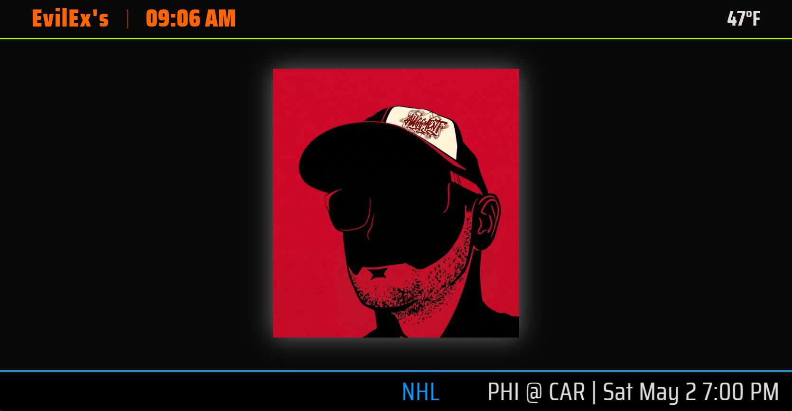
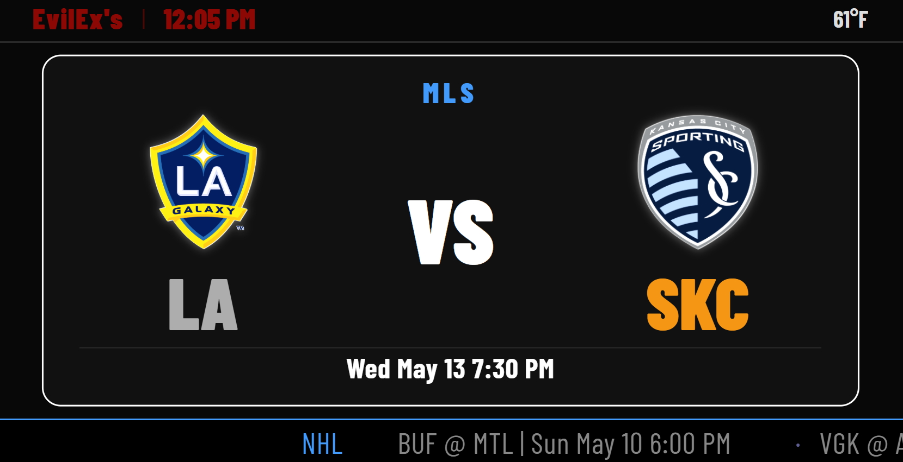
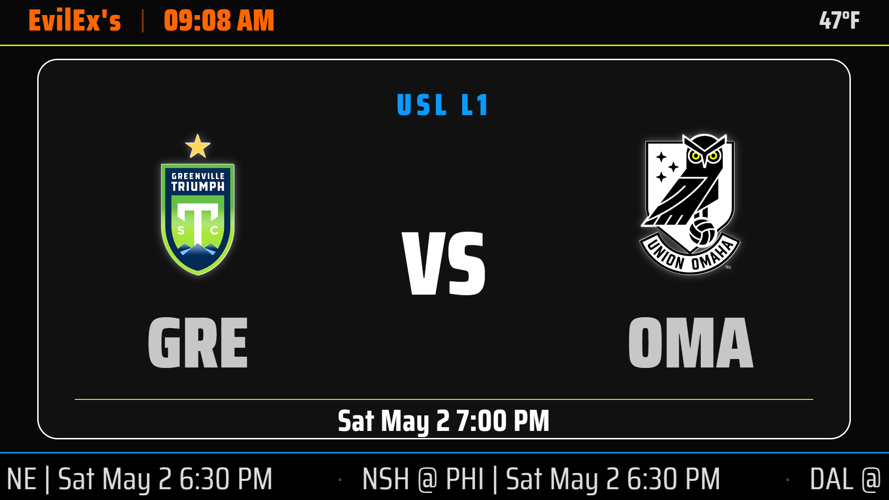
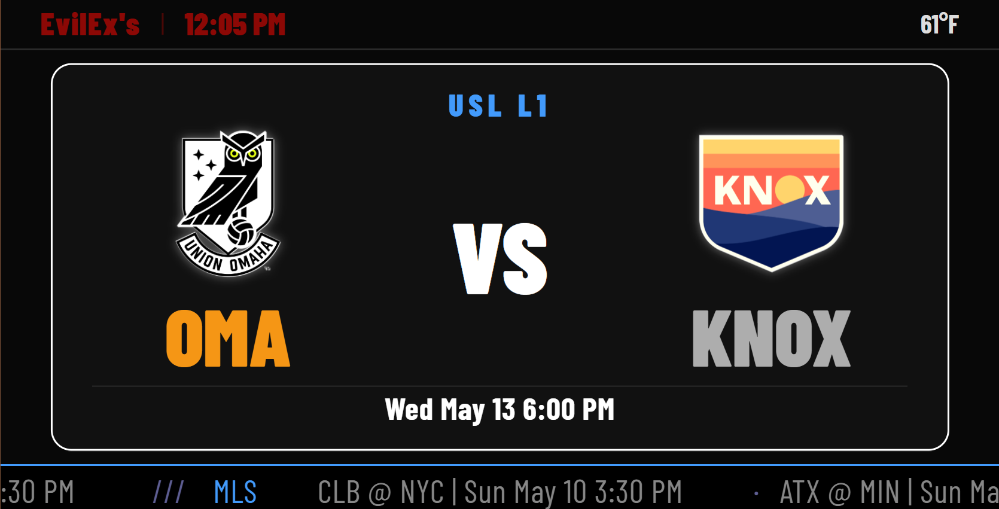

# Auggmented Scoreboard



## What's New in 1.5

Version 1.5 is about doing far less work for the same screen: the scoreboard now asks ESPN only when there is something new to learn, and it remembers what it learned.

* **Smart polling** — scores are only polled while a game is in progress or about to start. A game that is days away costs nothing between schedule checks. See [Smart Polling & Offline Mode](#smart-polling--offline-mode).
* **Schedule checks a few times a day** — game times are re-verified just after midnight, then at 6 AM, noon and 5 PM (midnight and noon only, when nothing you follow starts within 24 hours), so a rescheduled game is still caught.
* **Offline mode** — league schedules, team lists and colors, local school schedules, weather and your favorite teams' logos are saved to disk (`cache/`). A restart or an internet outage keeps showing the last known data instead of a blank screen.
* **Far fewer API calls** — a live score update is one request for today instead of one per day of the look-ahead window; local school feeds and weather are no longer re-fetched on every 30-second kiosk refresh; failures back off instead of retrying constantly.
* **Fixes** — leagues requested by a kiosk keep refreshing (they used to freeze after the first load); an HTTP 4xx from ESPN (e.g. an off-season series) is treated as "no data" rather than an outage.
* **New setting** — `live_favorites_only` (in `settings.json`) so only games involving your favorite teams wake the live poller.
* **Packaging** — a new `smartcache.py` module ships alongside `app.py` (installer, update package and release zip all include it).

Upgrading from 1.3 needs no changes to your settings; the cache builds itself on first run.

## What This Is

Auggmented Scoreboard turns any spare TV into a live, always-on sports ticker for the games you actually care about. Point it at a TV in the kitchen, the garage, the man cave, a break room, a sports bar, a gym, or a church fellowship hall — anywhere people glance up wanting to know the score right now instead of waiting for it.

The problem it solves: national broadcasts and generic score tickers cycle through dozens of games you don't care about before they ever get to yours, and they almost never carry your local high school, college, or rec-league team at all. This app skips all of that. You tell it which leagues and which specific teams matter to you — your NFL team, your kid's high school football team, your alma mater's basketball team, your local NASCAR driver — and it shows *those* scores, live, on a loop, with no waiting and no noise from games or markets that don't mean anything to you.

It pulls real-time scores from ESPN for the major pro and college leagues, plus dedicated leaderboard views for racing (NASCAR, IndyCar, F1) and golf (PGA), and it can also pull in local school schedules directly from your school's athletics page (Thrillshare, MaxPreps, RSS, or iCal calendars) — so the same screen showing the Chiefs score can also show "Auburn HS Football @ Home — Friday 7:00 PM."

## What It Does

* **Live Scores & Tickers** — Real-time scores for NFL, CFL, XFL, MLB, NBA, WNBA, EuroLeague, NHL, NCAA hockey, MLS, NWSL, top European soccer leagues (England, Spain, Germany, Italy, France, Netherlands, Portugal, Scotland, Greece, Turkey) plus Liga MX, Brasileirão, Argentina, UEFA Champions/Europa/Conference League, World Cup & qualifiers, college football/basketball/baseball/softball/volleyball/hockey/lacrosse, MiLB, USL, lacrosse (PLL/NLL), cricket (IPL, BBL, CPL, County), and rugby (Prem Rugby, Top 14, URC, 6 Nations, MLR, World Cup).
* **Racing & Golf** — Dedicated leaderboard cards for NASCAR, IndyCar, F1, and PGA, with your favorite drivers/golfers highlighted even when they're outside the top 10.
* **Local Sports Integration** — Automatically parses your school's or league's calendar (Thrillshare, MaxPreps, RSS, or iCal) to show upcoming local games right alongside the pro and college scores.
* **Kiosk/Server Architecture** — Run one central Server that pulls all the data, and pair as many Kiosk displays (TVs) to it as you want. Each kiosk shares the same live data but can have its own name, colors, orientation, and theme.
* **Fully Customizable Look** — Pick a dark or light theme, a display font, and a color for nearly every element on screen (scores, team names, ticker, racing leaderboards, card backgrounds) from the Settings page — no code required.
* **Smart Automation** — Scheduled display on/off times, automatic Wi-Fi management, and self-updating from GitHub releases or a local update package.
* **Quiet on the Network** — Polls ESPN only around game time, checks for changed start times a few times a day, and keeps an offline copy of schedules, teams and favorite logos. Details in [Smart Polling & Offline Mode](#smart-polling--offline-mode).

## Smart Polling & Offline Mode

The scoreboard is deliberately quiet on the network. It only talks to ESPN when there is something to learn:

* **Schedule checks** — the whole date window is re-read a few times a day (just after midnight, then 6 AM, noon and 5 PM) to catch changed game times. When nothing you follow starts within 24 hours it drops to just midnight and noon.
* **Live polling** — a league is polled for scores only while one of its games is in progress or about to start (from 5 minutes before kickoff), and only for *today's* slate — one request instead of one per day of the window. A game that is days away costs nothing between schedule checks.
* **Slow sports** — PGA and cricket poll every few minutes, not every 30 seconds.
* **Failures back off** (30 s → 15 min) and a dead connection stops after the first failed request instead of timing out repeatedly.
* **Everything is cached on disk** in `cache/` next to `app.py`: league schedules, team lists and colors (7 days), local school/league feeds (3 hours), weather (30 minutes), and the logos of your favorite teams. After a restart or with the internet down, the last known schedule, teams and logos still display.

Set `"live_favorites_only": true` in `settings.json` to have only games involving your favorite teams wake the live poller. `GET /api/cache/status` (admin) shows what each league is doing and when it will next poll.

## Requirements

* **Operating System**
  * Raspberry Pi: Raspberry Pi OS (Lite is recommended for Server; Desktop for Kiosk/Combined).
  * Generic PC: Debian or Ubuntu-based Linux distributions.
* **Hardware**: Raspberry Pi 5 or any x86_64 PC, plus a TV or monitor for Kiosk/Combined mode.
* **Environment**: The installer targets a non-graphical (CLI) fresh OS install. For Kiosk/Combined mode it installs and configures its own minimal window manager (Openbox) and display server (X11) — you don't need a desktop environment pre-installed.

## Installation

**1. Prepare the OS**

Start with a fresh install of Raspberry Pi OS or Ubuntu/Debian.

**2. Download Files**

Place `app.py`, `smartcache.py`, `install.sh`, `version.txt`, `requirements.txt`, and the `templates/` and `static/` folders together in a directory (e.g. `/home/pi/scoreboard`).

**3. Run the Installer**

```bash
chmod +x install.sh
sudo ./install.sh
```

**4. Choose Your Mode**

- **Server** — No display, headless data backend other kiosks point to.
- **Kiosk** — Display-only client that points to a server (or runs standalone).
- **Combined** — Server and display together on one machine — the simplest single-TV setup.

## Accessing the Settings Page

Once installed, find the device's IP address (`hostname -I` on the Pi, or check your router's connected-devices list), then open a browser to:

| Mode               | Default Port | Settings URL                          |
|---------------------|:---:|----------------------------------------|
| Server              | `5000` | `http://<device-ip>:5000/settings`  |
| Combined            | `5000` | `http://<device-ip>:5000/settings`  |
| Kiosk               | `5001` | `http://<device-ip>:5001/settings`  |

**Default login is `admin` / `root`** — change this immediately from the Settings page (Admin Credentials section) once you're in.

If you can't find the device's IP (e.g. no DHCP, no router access), `install.sh` automatically assigns a fallback static IP of **`192.168.1.250`** on the wired Ethernet port as a failsafe — connect a laptop to the same switch/router and browse to `http://192.168.1.250:5000/settings` (or `:5001` for kiosk-only installs).

## Google Chrome Troubleshooting (x86_64)

On PC-based Linux (x86_64), the script prefers Google Chrome for kiosk stability, while Raspberry Pi (ARM) always uses Chromium.

**If Chrome fails to install:**

**Manual Download** — If the installer can't find the `.deb` file, download it yourself:

```bash
wget https://dl.google.com/linux/direct/google-chrome-stable_current_amd64.deb
```

**Placement** — Put the `.deb` file in the same folder as `install.sh` before running it.

**Dependency Fix** — If you see "broken packages," run:

```bash
sudo apt --fix-broken install
```

**Fallback** — If Chrome still isn't found, `install.sh` automatically falls back to `chromium-browser`.

## Service Management

```bash
# Check status
sudo systemctl status scoreboard.service

# Restart after config changes
sudo systemctl restart scoreboard.service

# View live logs
sudo journalctl -u scoreboard.service -f

# Stop the service
sudo systemctl stop scoreboard.service

# Reset the offline cache (rebuilds automatically)
sudo rm -rf <install-dir>/cache && sudo systemctl restart scoreboard.service
```

On Kiosk/Combined installs, the browser itself is managed separately:

```bash
# Check kiosk browser status
sudo systemctl status kiosk.service

# Restart the kiosk browser
sudo systemctl restart kiosk.service

# View kiosk browser logs
sudo journalctl -u kiosk.service -f
```

## How It Works & Tips

### Pairing Kiosks

On the Server's Settings page, generate a one-time "Pairing Code" (valid for 10 minutes). Enter the Server's URL and that code on the Kiosk's Settings page to securely link it to the Server's data feed.

### Local Schedules

Go to Settings → Local Schedule and paste the URL of your school's or league's athletics page (or a MaxPreps link). The app automatically detects the feed type (Thrillshare, MaxPreps, iCal, or RSS) and pulls in upcoming games. Feeds are re-read every 3 hours (school schedules rarely change); if the site is down the last good copy keeps showing.

### Display Control

The app uses `xset` to control the TV over DPMS/HDMI-CEC for the scheduled "Power On/Off" feature, and `unclutter` to keep the mouse cursor hidden on kiosk displays.

## Troubleshooting

* **Apache2 "It Works!" Default Page Instead of the Scoreboard** — That page belongs to Apache2, not this app. The scoreboard listens on port `5000` (Server/Combined) or `5001` (Kiosk), not port 80 — browse to `http://<device-ip>:5000/` instead of the bare IP. If Apache2 isn't needed on that machine, remove it with `sudo systemctl disable --now apache2 && sudo apt purge -y apache2`.
* **Black Screen on Boot** — Check `systemctl status kiosk.service`. Make sure graphics drivers are installed if it can't open the display.
* **Unstyled / Broken-Looking Page** — Confirm `static/css/main.css` exists under the install directory; re-run `install.sh` if it's missing.
* **Data Not Updating** — Check backend logs with `journalctl -u scoreboard -f` and verify the machine has internet access to reach ESPN's APIs. Remember that 1.5 deliberately does not poll games that are days away: open `/api/cache/status` (logged in as admin) to see each league's last fetch, failure count, and whether it is currently being polled live. While offline the last known schedule keeps displaying, and the app retries with growing delays (up to 15 minutes).
* **Stale or Wrong Schedule After a Change** — Press **FORCE REFRESH** on the Settings page, or delete the `cache/` folder next to `app.py` and restart the service; it rebuilds itself on the next load.
* **Sudo Errors** — The app needs specific `NOPASSWD` entries in `/etc/sudoers.d/scoreboard` to control the display and services from the web UI. These are created automatically by the installer.

## Screenshots

| | |
|---|---|
|  |  |
|  |  |
|  |  |
